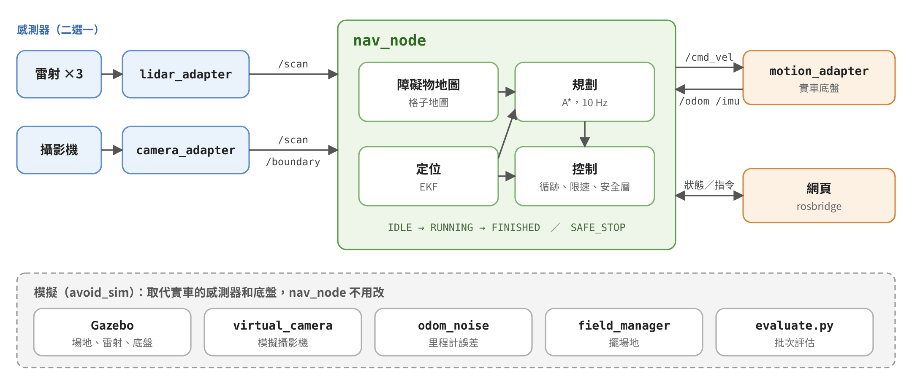
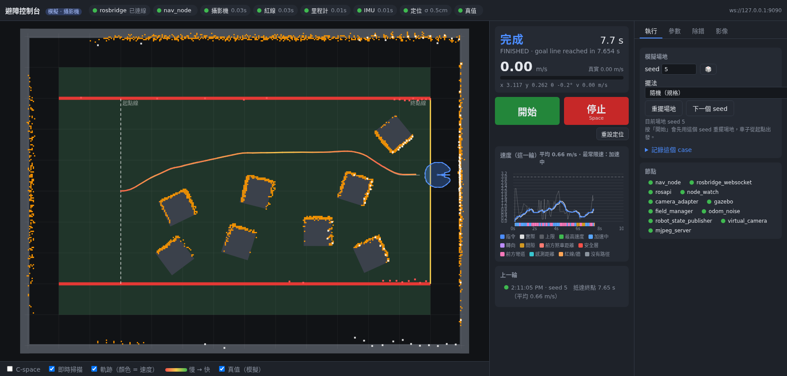

# RoboSot 避障挑戰系統

本專案是以 ROS Noetic 建置的自主避障系統，適用於 FIRA RoboSot 避障挑戰。系統負責感測器資料整合、定位、路徑規劃、速度控制與安全停車，並以相同的導航核心支援 Gazebo 模擬與實體機器人。

系統提供兩種感測器配置：

- **Camera**：使用全景攝影機辨識障礙物、紅線與場地邊界。
- **LiDAR**：整合三具 Hokuyo 雷射掃描器，提供 360 度障礙物資料。

## 主要功能

- 模擬與實車共用同一套導航核心，透過轉接層切換資料來源與底盤介面。
- 支援全景攝影機與三雷射兩種感測器配置。
- 整合 EKF 定位、障礙物地圖、A* 路徑規劃、路徑追蹤與動態限速。
- 依車體實際外型進行碰撞檢查，並在感測器逾時或定位異常時進入安全停止狀態。
- 提供網頁控制台、執行狀態監控、參數調整與問題案例記錄。
- 提供可重現的 Gazebo 場地、批次評估與回歸測試工具。

## 系統架構



感測器轉接層會將不同來源統一為 `/scan`、`/boundary`、`/odom` 與 `/imu/yaw`。導航節點只依賴這組標準介面，完成定位、規劃及控制後，再由 `/cmd_vel` 將速度指令送往 Gazebo 或實車底盤。

| 套件 | 職責 |
| --- | --- |
| [`avoid_msgs`](avoidance/avoid_msgs/) | 定義系統狀態、控制命令、場地重設與案例儲存介面。 |
| [`avoid_nav`](avoidance/avoid_nav/) | 實作感測器轉接、定位、地圖、路徑規劃、控制與安全機制。 |
| [`avoid_sim`](avoidance/avoid_sim/) | 提供 Gazebo 場地、機器人模型、虛擬攝影機、里程計雜訊與評估工具。 |
| [`avoid_bringup`](avoidance/avoid_bringup/) | 提供模擬與實車啟動腳本、tmux 工作階段與網頁控制台。 |

## 執行環境

- Ubuntu 20.04
- ROS Noetic
- Gazebo 11
- catkin
- Python 3
- tmux

## 編譯

以下範例假設此專案位於 `~/kymavoid_ws/src/kymavoid`：

```bash
cd ~/kymavoid_ws
catkin_make
source devel/setup.bash
```

## 快速開始

### Gazebo 模擬

```bash
cd ~/kymavoid_ws/src/kymavoid

# 全景攝影機配置
./avoidance/avoid_bringup/scripts/avoid_sim.sh camera

# 三雷射配置，並指定場地 seed
./avoidance/avoid_bringup/scripts/avoid_sim.sh lidar --seed 5
```

啟動完成後，終端機會顯示網頁控制台位址，預設為 `http://<主機 IP>:8000/`。控制台可用於重設場地、開始或停止任務、檢視系統狀態，以及調整導航參數。

停止所有避障相關程序：

```bash
./avoidance/avoid_bringup/scripts/avoid_stop.sh
```

### 實體機器人

```bash
# 全景攝影機配置
./avoidance/avoid_bringup/scripts/avoid_real.sh camera

# 三雷射配置
./avoidance/avoid_bringup/scripts/avoid_real.sh lidar
```

啟動腳本會檢查 ROS 套件、連接埠、設定檔與感測器裝置權限；檢查未通過時會停止啟動並顯示原因。

## 網頁控制介面



網頁控制介面整合系統狀態、場地地圖、啟停控制、速度紀錄、參數調整與除錯資訊。啟動模擬或實車後，以瀏覽器開啟終端機顯示的網址即可使用。

## 測試與評估

模擬啟動後，可在 tmux 的 `shell` 視窗執行批次評估：

```bash
rosrun avoid_sim evaluate.py --seeds 1-20 --layout route
```

重跑已記錄的問題案例：

```bash
./avoidance/avoid_bringup/scripts/run_cases.sh
./avoidance/avoid_bringup/scripts/run_cases.sh lidar
```
