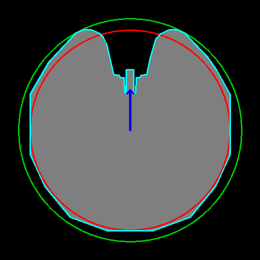

# 避障系統重新規劃

分支：`avoidance-redesign`

目前進度：已經能在 Ubuntu 20.04 / ROS Noetic / Gazebo 11 上編譯並跑完模擬避障（見這個分支的前 3 個 commit）。這份文件規劃接下來的重構。

---

## 0. 現況盤點

### 0.1 目前的資料流（模擬模式）

```
Gazebo 雷射 (/ob_scan, /scan)
  → scan_tf (Python)：轉成 120 個扇區的距離 (cm)，發 /vision/BlackRealDis、/vision/redRealDis
  → FIRA_strategy：RoutePlan 找洞口 → 人工勢場修角度 → v_fast 加減速
  → pubSpeed：依編譯旗標 GAZEBO_SIMULATOR 決定送到
       模擬：nubot1/nubotcontrol/velcmd（nubot_common/VelCmd）
       實車：/motion/cmd_vel（geometry_msgs/Twist）
  → nubot_gazebo plugin（模擬） / Attack_motion_node（實車）
```

另外還有幾個節點和訊號：
- `teamStrategy`：只負責分配角色。
- 網頁：`IsSimulator`、`GameState`、`avoid_go` 三個訊號合起來，決定能不能開始跑。
- `avoidance`：只負責畫 `/camera/avoid` 這張除錯圖。

實車的障礙物感測器是**兩種設定二選一**，**攝影機是主要方案，雷射是備案**：

| 設定 | 感測器 | 看得到紅線嗎 | 節點 | launch |
|---|---|---|---|---|
| 雷射（備案） | 3 顆 Hokuyo（見 2.3）。舊程式和 launch 寫的是 4 顆（`/hokuyo_1..4/scan`、`multiple_4*.launch`） | **看不到** | `vision/laser` | `laser_avoid.launch` |
| 攝影機（主要） | 全景攝影機（prosilica，`192.168.16.100`） | 看得到 | `vision/black_item` | `AvoidChallenge.launch` |

兩種設定最後都輸出同樣的 120 扇區格式（`/vision/BlackRealDis`、`/vision/redRealDis`）。

雷射設定下其實不使用攝影機，但目前的程式還是會把攝影機帶起來，這是不應該的：
- `laser_avoid.launch` 會啟動 `prosilica_driver`；
- `vision/laser` 會訂閱 `/camera/image_raw`，從影像算出 `redRealDis`（[laser.cpp:6](../vision/laser/laser.cpp#L6)、[laser.cpp:346](../vision/laser/laser.cpp#L346)）。

新設計的雷射設定不會啟動攝影機。

> ⚠️ **在舊程式上不能只把攝影機從 launch 拿掉**（見 P10）。FIRA_strategy 會讀紅線距離，攝影機一拿掉，它讀到的就是沒有初始化的記憶體。

兩種設定都有馬達回授 `/motion/motionFB` 和 IMU `/imu_3d`，但目前的避障幾乎沒用到它們。舊程式曾經用 `/motion/motionFB` 積分橫向位置（`FB_XX`，原本的註解寫「這邊有疑問」），可是算出來的 `main_vec` 緊接著就被 `main_vec = 60;` 覆蓋，等於關掉了（[FIRA_pathplan.cpp:538-551](../strategy/FIRA_strategy/FIRA_pathplan.cpp#L538-L551)）。

### 0.2 問題清單

| # | 問題 | 證據 |
|---|---|---|
| P1 | team strategy 是空殼 | [FIRA_teamStrategy.cpp](../strategy/FIRA_teamStrategy/FIRA_teamStrategy.cpp) 寫死 `switch(1)`，永遠發 `Role_AvoidBarrier`；而 [FIRA_pathplan.cpp:105-112](../strategy/FIRA_strategy/FIRA_pathplan.cpp#L105-L112) 連 `Role_Halt` 都去跑避障。避障模式下角色完全沒作用 |
| P2 | 足球的殘留程式造成錯誤和 crash | teamStrategy 找 `soccer`、`R1` model 時越界（已在 `d9bab9a` 修好）。nubot_gazebo plugin 掛在車子和 8 個障礙物上，一共 9 份，每份都去找 `football` 並刷錯誤 log，還各自開 2 條 thread 訂閱 `model_states`。另外還有 `BallHandle`/`Shoot` service、`pubShoot`，以及 `Env.h` 裡球、球門、對手的結構 |
| P3 | 模擬和實車要重新編譯才能切換 | [strategy_nodeHandle.h:16](../strategy/FIRA_strategy/strategy_nodeHandle.h#L16) 用 `#define GAZEBO_SIMULATOR` 切換；兩邊的速度軸向定義也不同（`pubSpeed` 裡 Vx/Vy 對調、正負號不同） |
| P4 | 沒有空間概念 | 只看當下這一幀的 120 個扇區：沒有定位、沒有地圖、沒有記憶，也沒有「終點」或「完成」的判斷 |
| P5 | 沒有真正的速度規劃 | `v_fast` 用固定步伐加減，範圍 0–100（[FIRA_pathplan.cpp:1007-1095](../strategy/FIRA_strategy/FIRA_pathplan.cpp#L1007-L1095)）；`v_yaw` 永遠是 0；煞車距離沒考慮實際速度和減速度 |
| P6 | 角度慣例難以維護 | 扇區 index 60 是車頭、30 是左、90 是右，每格 3°；`motor_place` 用 `num*3+180` 轉回馬達角度。和 ROS 的 REP 103 慣例不一致 |
| P7 | 啟動流程容易出錯 | 要開 3 個以上終端機、照順序手動 `rosrun`。`IsSimulator=0` 只在網頁載入或按「連接策略」時送一次，策略節點比網頁晚開就會漏收。曾經因為終端機殘留 `ROS_IP` 整條斷線，卻沒有任何提示 |
| P8 | 網頁看不出真實狀態 | 連線燈只反映 websocket（[RobotConnect.js:30-46](../web/新避障/js/RobotConnect.js#L30-L46)），看不出策略節點有沒有活著、資料有沒有在流。開始要經過「連接策略 → 解鎖 → Start」，每一步都只送出、不確認。功能分散在 3 套網頁（`Vision_UI`、`scan_web`、`新避障`） |
| P9 | 結果無法客觀比較 | 同樣設定跑兩次，一次離障礙物最近 5 cm，一次擦撞，路線也不一樣。沒有批次評估工具，改了參數也不知道有沒有變好 |
| P10 | 雷射設定的紅線資料不明確 | 策略會讀 `reddis`：左右 70 cm 內有紅線時設定 `RedLine`，進而影響人工勢場（[FIRA_pathplan.cpp:878-904](../strategy/FIRA_strategy/FIRA_pathplan.cpp#L878-L904)、[:1241](../strategy/FIRA_strategy/FIRA_pathplan.cpp#L1241)）。但 `global_env` 是用 `new Environment` 建立的（[strategy.cpp:88](../strategy/FIRA_strategy/strategy.cpp#L88)），`reddis[360]` 沒有初始化。沒有紅線資料時讀到的值不確定，如果剛好是 0，就等於「兩側 0 cm 處都有紅線」 |
| P11 | 碰撞模型太粗糙（**模型部分已修正**，見 2.2） | 舊策略把車子當成 r=20 cm 的圓（[FIRA_pathplan.cpp:436](../strategy/FIRA_strategy/FIRA_pathplan.cpp#L436)），還到處寫死門檻；實車約 40 × 40 cm 而且不是圓的，四個角超出 20 cm。Gazebo 裡的模擬車又被縮小了 10%（見 2.2） |
| P12 | 模擬讓雷射看到實際看不到的東西 | 模擬裡紅線是 1.5 m 高的牆，外圍矮牆其實高 0.95 m。實測在場地末端 (2.96, −0.20) 的一幀：障礙物雷射打中 108 點，**其中 88 點（81%）打在實際場地看不到的牆上**，只有 20 點打在障礙物上。另外有一顆裝在 1.2 m、只看得到紅線牆的雷射。結果是：定位在模擬裡會被高估，紅線也根本越不過去（只會撞牆） |

---

## 1. 從 team strategy 解耦

**結論：不需要耦合。** 避障是單機任務，team strategy 和角色機制在這裡只增加故障點（P1、P2）。

### 1.1 做法

新增一個獨立的套件 `avoid_nav`。舊的 `strategy` 套件維持原樣，**足球功能保留、不去動它**；避障流程不再依賴它。

```
感測器轉接層（三選一）           避障核心 (avoid_nav)                底盤轉接層
─────────────────             ──────────────────                ─────────
模擬：Gazebo 的 3 顆雷射     ┐
實車雷射：3 顆 Hokuyo 合併    ├→ /scan ─→                         → 模擬：gazebo_ros_planar_move
實車攝影機：全景影像轉距離   ┘    /boundary（攝影機設定才有）─→     /cmd_vel → /odom
                                   定位 / 規劃 / 速度規劃 / 狀態機 → 實車：motion_adapter
里程計 /odom、航向 /imu/yaw ──→                                   /cmd_vel → /motion/cmd_vel
```

不論是哪一種障礙物感測器，都在轉接層統一轉成 `/scan`，避障核心不需要知道資料從哪裡來。以後換感測器設定，只要換轉接層。

### 1.2 統一介面

| Topic / Service | 型別 | 說明 |
|---|---|---|
| `/scan` | `sensor_msgs/LaserScan` | 障礙物，`base_link` 座標系 |
| `/boundary` | `sensor_msgs/LaserScan` | 看得到的紅線點，**只有攝影機設定才有**，定位用它擬合紅線（3.2）。雷射設定的紅線由已知場地加上定位推算（3.4） |
| `/odom` | `nav_msgs/Odometry` | 輪速里程計的原始資料（車身速度）。模擬由 planar_move 提供、再加上雜訊；實車由 `motion_adapter` 提供 |
| `/imu/yaw` | `std_msgs/Float64` | 航向。實車從 `/imu_3d` 轉來，模擬由 Gazebo 提供 |
| `/avoid/pose` | `geometry_msgs/PoseWithCovarianceStamped` | **定位的輸出**：場地座標的位姿和不確定度（見第 3 節） |
| `/cmd_vel` | `geometry_msgs/Twist` | REP 103：x 往前、y 往左、z 逆時針 |
| `/avoid/command` | service | start / stop / reset，一定回傳成功或失敗 |
| `/avoid/status` | 自訂 msg，10 Hz | 狀態機狀態、各感測器最後更新時間、目前輸出的速度、定位品質、錯誤碼 |

### 1.3 模擬改用獨立的 `avoid_sim`

- 避障用自己的模擬套件 `avoid_sim`，包含車子模型、場地 world 和場地重設工具，細節見第 5 節。
- 底盤用 Noetic 內建的 `libgazebo_ros_planar_move.so`：直接吃 `/cmd_vel`、發 `/odom`，正好適合全向輪。障礙物設成 static，不掛任何 plugin。
- `nubot_gazebo` 和足球的 world 維持原樣，足球照常使用。避障模擬不載入 nubot plugin，所以 `football` 的錯誤 log、9 份重複的 plugin、`VelCmd` 的單位與軸向換算，都不會出現在避障流程裡。
- 備註：這個分支的前兩個 commit 為了在 20.04 上編譯，有改到 `nubot_gazebo` 和 `strategy` 的原始碼，但只是 API 移植、行為沒變。之後不再動它們。
- 模擬和實車的差別只剩轉接層，**用執行時的參數切換**，不必重新編譯（解決 P3）。

### 1.4 實車底盤轉接 `motion_adapter`

- 把 REP 103 的 `/cmd_vel` 轉成 `Attack_motion_node` 要的 `/motion/cmd_vel` 軸向。所有座標轉換只在這裡做（解決 P6）。
- 把 `/motion/motionFB`（車身速度 `x_speed`、`y_speed`、`yaw_speed`）轉成 `/odom`。
- 把 `/imu_3d` 的 `yaw` 轉成 `/imu/yaw`。

---

## 2. 規格與車體

### 2.1 規格：以目前的 Gazebo 模擬為準

沒有實際場地可以量，所以**規格一律以目前 Gazebo 模擬的設定為準**。Gazebo 裡沒有定義的項目由我暫定，在表裡標成「假設」，全部做成參數，之後可以改。

| 項目 | 規格 | 來源 |
|---|---|---|
| 場地地面 | 6 m × 4 m，x ∈ [−3, 3]、y ∈ [−2, 2] | `FIRA_Field` |
| 紅線 | 兩條，中心線在 y = ±1.5 m，線寬 5 cm，長 6 m（x ∈ [−3, 3]）。內緣在 \|y\| = 1.475 m，所以可以走的寬度是 2.95 m | `red_line` |
| 外圍矮牆 | 中心在 x = ±3.55 m、y = ±2.55 m，厚 15 cm。實際場地的雷射照不到 | `wall` |
| 障礙物 | 8 個，45 × 45 cm 的方塊，不旋轉 | `FIRA_Obstacle` |
| 起點 | **假設**：起點線在 x = −2.0 m，車子擺在線的正中間 (−2.0, 0)，車頭朝 +x。（目前模擬沒有起點線，車子出生在 (−2.0, −0.5)，不在中間） | `avoid_robot.launch` |
| 終點線 | **假設**：紅線的末端 x = +3.0 m。（目前模擬沒有終點線，`avoid_goal` 被註解掉了） | — |
| 終點後的煞車空間 | 從終點線到矮牆內緣（x = 3.475 m）只有 **47.5 cm** | 由上面推算 |
| 車子 | 用 robot6th URDF 的版本（見 2.2） | `robot6th.xacro` |
| 雷射 | 3 顆，見 2.3 | 已確認 |

規則（已確認）：
- 最快到達終點區就贏，不用來回。
- **全部都是「碰到就算」**：碰到障礙物算碰撞、碰到紅線算越線，兩者都直接判輸；車身碰到終點線就算到達。

所以目標是「**零碰撞、零越線的前提下越快越好**」，安全餘裕優先於速度。

### 2.2 車體外型：用 mask 取代圓形（模型已修正）

**車子用 robot6th URDF 的版本。** 原始 CAD 檔（`robot6th_cad_mm.stl`）有三個問題：單位是公釐、車頭朝 +y、原點偏離左右對稱軸 4 cm。過去每個模型各自用不同的方式補救，結果模擬車被縮小了 10%（P11）。

**已修正（這個分支）**：
- 新增 [make_robot6th_meshes.py](../simulator/robot6th/robot6th_description/scripts/make_robot6th_meshes.py)，從 CAD 檔產生三個檔案，全部用車體座標（公尺、x 往前、地面 z = 0、原點在外型中心）：
  - `robot6th.stl`：視覺用，面數從 33 萬降到 8.2 萬；
  - `robot6th_collision.stl`：把外型多邊形往上拉高 0.688 m 的柱體，是凹的、精確的；
  - `config/robot6th_footprint.yaml`：外型多邊形，**全系統唯一的一份**。
- `FIRA_laser_2`（避障模擬）和 `robot6th.xacro`（足球模擬）都改用這些 mesh。xacro 的連結和關節沒有變動。
- 外型 40.2 × 40.0 cm，最大半徑 22.3 cm。左右鏡像的重疊度（IoU）0.992，證實中心抓得正確。

下圖紅圈是舊的 r=20 cm，綠圈是能包住整台車的最小圓，青色是外型多邊形，藍色箭頭是車頭：



- 車頭有一個凹口；四個角超出 r=20 cm，左右兩側剛好貼著。
  - 用 r=20 cm 會低估四個角；
  - 用 r=22.3 cm 會高估兩側。
- **在 Gazebo 實際撞撞看**（隔離的 Gazebo，方塊和細柱都是 static）：

| 測試 | 停止位置 | 多邊形預測 | 舊圓形預測 |
|---|---|---|---|
| 車角撞方塊（足球 URDF） | 0.607 | 0.608 | 0.627 |
| 車頭凹口對準 4 cm 細柱（避障 SDF） | 0.859 | 0.859 | 0.780 |
| 車頭凹口對準 4 cm 細柱（足球 URDF） | 0.859 | 0.859 | 0.780 |

  細柱會伸進凹口 7.9 cm 才碰到，舊的圓形模型完全表現不出來。

外型多邊形的用途：
1. **規劃**：車子不轉向，航向固定朝終點，所以把障礙物和禁止區用 mask 膨脹，得到的可行空間是**精確的**，規劃器把車子當成一個點就好。航向控制有誤差（例如 ±2°）時，在這個角度範圍內取聯集再膨脹。
2. **安全層**：直接拿多邊形去檢查感測到的點，不經過地圖，精度不受格子大小限制。
3. **模擬與評估**：Gazebo 的碰撞用同一個形狀；評估工具判定碰撞和越線，也用同一個多邊形。

前提是**車子不轉向**。全向輪只做平移，舊程式也是這樣（`v_yaw` 永遠是 0），新設計用 IMU 閉迴路把航向固定在朝終點。

### 2.3 感測器

**主要方案：全景攝影機**

- 360°，每 3° 一條掃描線，共 120 條。`vision/black_item` 從影像裡找黑色障礙物和紅線，再用鏡面模型把像素半徑換算成「離車子中心的地面距離」（[nodehandle.cpp:97-121](../vision/black_item/nodehandle.cpp#L97-L121)）。
- 用預設校正值（`FIRA (default).yaml`：相機高 654 mm、內圈 40 px）算出的距離和精度：

| 像素半徑 | 離車子中心 | 1 px 代表 |
|---|---|---|
| 40 px（內圈） | 32 cm | 0.9 cm |
| 80 px | 78 cm | 1.5 cm |
| 100 px | 116 cm | 2.4 cm |
| 120 px | 180 cm | 4.5 cm |
| 140 px | 321 cm | 11.8 cm |

- **近距離很準、遠距離很粗**：1 m 以內 1–2 cm，2 m 左右約 5 cm，3 m 以外基本上不能用。
- **內圈盲區**：`black_item` 從內圈（離車子中心 32 cm）開始往外找第一個黑色像素。障礙物有 1 m 高，在影像裡是往外延伸的楔形，所以貼地位置在 32 cm 以內的障礙物**不會消失，而是會被回報成剛好 32 cm，也就是比實際遠**。車子半寬約 20 cm，所以車身外面大約一圈 12 cm 量不準。在 50 cm 的間隙裡，兩側的障礙物離車子中心只有約 25 cm，會被當成 32 cm，車子會以為多了 7 cm 的空間（見 4.1）。紅線是平貼在地上的，在 32 cm 以內則是真的看不到。
- 角度解析度 3°：在 1 m 遠的地方，兩條掃描線大約相距 5 cm。
- **看得到紅線**，而且越靠近越準。但實際影像顯示，紅線只有在 1 m 以內才偵測得可靠，兩條線同時偵測到的情況不多（2.4）。
- **也看得到紅線外的黑色矮牆**（2.4），這是雷射看不到的。
- 這張表是用預設校正值算的。實際的鏡面中心每個場次都不一樣（2.4），所以要在啟動時自動量測。

**備案：3 顆 Hokuyo**

- 裝在 60 cm 高，**平均分佈、彼此相差 120°**，其中一顆朝正後方，合起來涵蓋 360°。以車頭為 0°，分別朝 180°、+60°、−60°。
- 距離可以看到場地最遠端（沒被擋住的話）。型號不確定，角度解析度先當參數。
- 看不到紅線和外圍矮牆，**場上唯一看得到的是障礙物**。
- **會打到車子自己**（支架、線材等不在 CAD 裡的部件；CAD 在 60 cm 高只有中央 4 cm 的攝影機支柱）。過濾方式：把點轉到 `base_link` 之後，**落在車子外型多邊形 + 一點餘裕（例如 3 cm）以內的點，一律視為車體**。障礙物不可能出現在車子裡面，所以這個規則不需要知道自打部件的確切位置。
- 安裝的水平位置假設在外型以內、不突出。
- 這個設定不使用、也不啟動攝影機。

### 2.4 用實際影像驗證攝影機方案（`相關資料/`）

`相關資料/` 裡有 21 張實車的全景影像：1–13 號是同一個場次，case 系列是另一個場次。另外還有舊演算法的決策除錯圖，以及手寫的操作筆記。我照 `black_item` 的演算法（先左右翻轉影像、每 3° 一條射線、紅線用 `HSV/Ball` 的範圍、黑色用灰階門檻），在這些影像上重跑了紅線和黑色偵測：

| 項目 | 發現 | 對設計的影響 |
|---|---|---|
| 鏡面中心 | 同一場次內很穩定（差 1–2 px），但**不同場次相差約 38 px**：1–13 號約在 (274, 272)，case 系列約在 (298–303, 245–255)，預設值是 (302, 246)。外圈半徑穩定在 229–233 px | 在 1 m 附近，1 px 大約是 2.4 cm，所以中心偏 10 px，距離就錯大約 24 cm。**每次啟動時用 Hough 圓偵測自動量出中心**，取代手動「調圈圈位置」 |
| 紅線偵測 | 紅線在 1 m 以內時，單一條線有 25–47 條射線落在線上，擬合很穩定；在 1 m 以外，只剩 5–12 條，而且混著場外雜物。21 幀裡只有 12 幀擬合得出至少 5 點的直線，**兩條線同時偵測到的只有 6 幀** | 紅線只有在**靠近時**可靠，剛好是禁止區最需要準的時候；遠離紅線時只能靠輪速和 IMU（3.2） |
| 紅色誤判 | 場外的紅色板子、物品會被當成紅線。case 4 用 RANSAC 擬合出的最佳直線，其實是場外的一塊紅板 | **必須用預測的位姿過濾**，只接受預期紅線位置附近的點（3.2）。另外，紅線目前沿用的是球的 HSV 參數（`HSV/Ball`），要改成紅線專用的參數 |
| 黑色偵測 | 能準確描出障礙物貼地的邊緣。**也看得到場地外圍的黑色矮牆**。場外的人腳、桌椅也會被偵測到 | 矮牆的位置是固定的，**可能可以當攝影機定位的另一個絕對參考，而且可以修正 x**，但需要更多資料確認；場外的偵測要用場地邊界過濾掉（4.1） |
| 支架 | 鏡面的 3 根支架在固定方向（設定檔 `Dont_Search_Angle` 是 47°、164°、285°）。現在的 `black_item` 沒有遮掉它們，偶爾會產生 40 cm 以內的假障礙物 | 轉接層要遮掉這 3 個方向；虛擬攝影機也要模擬這 3 個盲角 |
| 曝光 | 筆記上寫「亮 → 慢、暗 → 快 → 不穩」，最高大約 60 fps | 幀率和延遲做成參數，虛擬攝影機也要模擬延遲 |

**限制**：只有 21 張靜態影像，沒有連續的影像，也沒有對應的真實位置，所以只能看出「偵測得到什麼」，量不出精度。建議在實車上錄 rosbag（原始影像、輪速、IMU），拿來離線測試攝影機轉接層、校正虛擬攝影機的雜訊模型（第 8 節）。

---

## 3. 定位

### 3.1 先釐清：定位要提供給誰

| 用途 | 需要什麼 | 從哪裡來 |
|---|---|---|
| 避開障礙物 | 車子**相對於**障礙物的位置 | 直接用當下的感測資料，加上短期記憶（4.1），**不依賴定位** |
| 不碰紅線 | 場地座標的橫向位置 y、航向 θ | 定位 |
| 判斷到達、決定何時煞車 | 場地座標的 x | 定位 |

障礙物的相對位置，感測器每一幀都直接量得到。定位真正不可取代的用途，只有紅線和終點這兩個需要「場地座標」的問題。所以**避障不靠定位**：定位的誤差只會影響紅線的安全距離，不會直接造成碰撞。

### 3.2 主要方案（攝影機）：輪速 + IMU + 紅線

全部自己寫，只需要 Eigen 和 roscpp。用一個 3 個狀態 (x, y, θ) 的 EKF：

| 步驟 | 來源 | 做法 |
|---|---|---|
| 預測 | 輪速 `/odom` | 車身速度轉到場地座標後積分。不確定度隨速度增加，橫向給大一點（全向輪的橫向比較會打滑） |
| 修正方向 | `/imu/yaw` | 直接修正 θ |
| **修正 y 和 θ** | **紅線** | 先用預測的位姿算出「紅線應該在哪裡」，只接受這附近的紅色點（例如 ±15 cm 以內、方向接近平行 x 軸），再擬合成直線。直線和車子的距離換算成 y，直線的角度換算成 θ。左右兩條線各自是一個獨立的觀測 |
| 修正 x 和 y（待驗證） | 外圍黑色矮牆 | 攝影機看得到矮牆（2.4），而且位置固定。一樣先用預測位姿過濾，再擬合直線；場地兩端的矮牆可以用來修正 x。要先用 rosbag 確認偵測夠穩定，才放進來 |

- **紅線是絕對參考**，y 和 θ 不會隨路程漂移。但實際影像顯示，**只有離紅線 1 m 以內才可靠**（2.4）。遠離紅線時只能靠輪速和 IMU，不確定度會變大；不過這時候離紅線也遠，安全距離本來就夠。
- **一定要過濾**：場外的紅色物品會被誤判成紅線（2.4）。沒有用預測位姿過濾的話，RANSAC 會選到錯的線。
- **起始方向擺歪了也能修正回來**：看到紅線的角度，就知道車子歪了多少。這是雷射方案做不到的（3.4）。
- 擬合用了很多條掃描線，比單一條線的解析度準；而且越靠近紅線越準。
- 紅線和 x 軸平行，所以**紅線修正不了 x**。x 先靠輪速和 IMU 推算，誤差大約是行駛距離的幾個百分比。x 只影響「什麼時候判斷到達」和「終點前什麼時候開始煞車」，所以在煞車距離裡預留這個誤差即可。如果黑色矮牆驗證可行，就可以拿來修正 x。
- 紅線被障礙物擋住、或暫時沒看到時，只靠輪速和 IMU，不確定度會變大，禁止區的安全距離也跟著放大（3.4）。

### 3.3 備案（雷射）：錨定地圖 + ICP

雷射看不到紅線，沒有絕對參考，所以改用「車子在起點時看到的障礙物」當參考：

- **錨定地圖**：起點位姿已知，車子在起點靜止大約 1 秒，把 3 顆雷射合併後的點累積成場地座標的點地圖。雷射可以看到場地最遠端，所以沒被擋住的障礙物在起點就都看得到。
- **EKF**：輪速預測、IMU 修正方向，再拿當下的掃描對錨定地圖做 point-to-line ICP 來修正位置。
- **ICP 的保護機制**：
  - 退化處理：從 Hessian 判斷哪個方向的約束不足，只在約束夠的方向修正；
  - 修正量太大（例如超過 15 cm 或 3°）時，視為錯誤配對丟掉；
  - 新看到的障礙物，要連續幾幀都穩定、而且比對品質好，才加進地圖。
- 3 顆雷射的合併：每顆依安裝位置轉到 `base_link` 後合併，幾十行程式。合併時先做**自打過濾**（2.3）：外型多邊形 + 餘裕以內的點丟掉。

### 3.4 紅線禁止區

紅線在場地座標裡的位置是固定的（2.1），所以把紅線本身（含線寬）和線外設成禁止區。碰到就算越線，所以車子的 mask 不能碰到禁止區。規劃時，禁止區用 mask 膨脹，再往內縮一段安全距離，作為定位誤差的預算：

| | 攝影機（主要） | 雷射（備案） |
|---|---|---|
| 場地座標從哪裡來 | 紅線，絕對參考，一直在修正 | 只有起點擺放的位置，之後靠比對維持 |
| 起點擺歪的影響 | 看到紅線就修正回來 | **修不回來**：歪 1° 到 6 m 外約偏 10 cm，歪 3° 約偏 31 cm |
| 安全距離（參數） | 可以小，依擬合誤差決定 | 要比較大，依實測漂移決定；起點要用治具對齊 |

安全層也要檢查「以目前速度煞停之後，mask 會不會碰到禁止區」。

### 3.5 考慮過但不採用的方案

| 方案 | 不採用的原因 |
|---|---|
| 現成的 SLAM 套件（slam_toolbox、gmapping、cartographer、hector） | 為大範圍、特徵多、有迴圈的環境設計。這裡特徵少、沒迴圈、起點已知，殺雞用牛刀，行為也比較難掌握 |
| 只用輪速和 IMU | 全向輪容易打滑，誤差只會一路累積；舊程式試過，後來停用了 |
| 把攝影機的距離放進 ICP 比對 | 遠距離的解析度太粗（2 m 約 5 cm、3 m 約 12 cm），比對會不穩定；而且已經有更好的紅線可以用 |
| 先建地圖再在地圖上避障 | 定位誤差會變成障礙物位置的誤差，見 3.1 |
| 用「方塊」當地標的 EKF-SLAM | 要假設障礙物都是已知尺寸的方塊。雷射備案的點比對如果精度不夠，再當成升級方案 |

### 3.6 驗證

在模擬裡用 Gazebo 的真值、里程計有加雜訊的條件下，比較各種組合的誤差：只用輪速、輪速加 IMU、再加紅線（攝影機）、再加錨定地圖比對（雷射）。驗收標準見第 8 節。

---

## 4. 避障規劃

### 4.1 障礙物的表示：當下的感測資料加上短期記憶

- 用**當下這一幀**的障礙物點建立局部格子地圖，解析度 2 cm，再用 mask 膨脹（2.2）。車子和障礙物的相對位置是這一幀直接量到的，不受定位誤差影響。
- **短期記憶在攝影機方案是必要的**：攝影機會把 32 cm 以內的障礙物回報成 32 cm（2.3），而通過 50 cm 間隙時，兩側的障礙物大約只在 25 cm 外。所以回報值等於內圈距離的點不能照單全收，要用最近大約 1 秒內、還在 32 cm 外時看到的點，透過輪速和 IMU 的相對位移帶到現在的位置。短距離的相對位移很準，足以應付這段。雷射方案也用同一套機制，來補 3 顆雷射之間的死角和被遮擋的地方。
- 遠處的點精度比較差（2.3），所以每個點都附帶「越遠越不準」的誤差，膨脹時加上這個誤差。真正需要精準的是靠近車子的點，而攝影機在近距離剛好最準。
- **過濾場外的偵測**：場外的人、桌椅也會被偵測成黑色障礙物（2.4）。用定位的位姿，把「明顯在紅線外面」（例如超過 30 cm）的點濾掉。只濾明顯在外面的點，避免定位誤差把真的障礙物也濾掉。
- 禁止區（3.4）用定位的位姿放進同一張圖，同樣用 mask 膨脹，再加上安全距離。

### 4.2 路徑規劃

| 層 | 做法 |
|---|---|
| 全域 | 在可行空間上用 A* 規劃到「mask 碰到終點線」的任何位置，5–10 Hz 重新規劃 |
| 局部 | 全向輪的 pure pursuit：沿路徑取一個前視點，直接平移過去，不轉向 |
| 安全層 | 獨立於規劃器：用多邊形檢查原始雷射點和禁止區，即使規劃器出錯也能擋住 |

另一個選擇是 `move_base`（`global_planner` 加 `dwa_local_planner`，開 holonomic）。但它的 costmap 是用圓形半徑膨脹，沒辦法利用「航向固定」做精確的 mask 膨脹；碰到就判輸、終點線這些比賽專屬的邏輯也還是要自己寫。所以建議自己寫 A* 和 pure pursuit。

### 4.3 安全層

每個控制週期都做：
- 把多邊形沿著速度方向掃過「煞停距離 + 餘裕」，掃過的範圍內只要有任何雷射點，就減速或停車。
- 檢查煞停的位置，mask 會不會碰到禁止區。
- 感測器資料逾時、定位品質太差時，直接停車。

### 4.4 速度規劃（取代 `v_fast` 的加減步伐）

- 加速度和 jerk 都設上限，走 S-curve（可以參考舊程式的 `velocity_S_planning`）。
- 依照可用空間限速：`v ≤ sqrt(2 · a_brake · (d_free − margin))`。`d_free` 是沿著移動方向，mask 到最近障礙物或禁止區的實際距離。
- 依照路徑的轉折限速。窄縫（例如 50 cm，兩側各只剩 4.9 cm）要用低速通過。
- **終點**：碰到終點線就算到達，原則上可以全速衝線。但終點線後面到矮牆只有 47.5 cm（2.1），所以衝線速度有上限：`v_finish ≤ sqrt(2 · a_brake · (0.475 m − margin))`。例如減速度 2 m/s²、餘裕 10 cm，大約是 1.2 m/s。
- 最高速度、加減速、安全距離都做成參數，可以從網頁調整。

### 4.5 狀態機

```
IDLE ─start→ MAPPING（起點靜止約 1 秒，建錨定地圖）→ RUNNING ─mask 碰到終點線→ FINISHED（煞停）→ IDLE
  ↑                                                    │
  └────────stop──────────────────────────────────────┤ 感測器逾時、定位品質太差 → SAFE_STOP（停車並回報原因）
                                                       └ 卡住超過 N 秒 → 嘗試脫困；失敗就進 SAFE_STOP
```

---

## 5. 模擬：`avoid_sim`

### 5.1 場地、車子、感測器（要和實車一致）

| 項目 | 現在的模擬 | 新的 `avoid_sim` |
|---|---|---|
| 紅線 | 1.5 m 高的牆，雷射看得到，也越不過去 | **貼在地上的平面，只有外觀、沒有碰撞**，雷射看不到。越線改由評估工具用幾何判定 |
| 外圍牆 | 0.95 m 高，雷射看得到 | 改成低於 60 cm 的矮牆（例如 20 cm），雷射看不到；煞車不及時會真的撞上 |
| 起點線、終點線 | 沒有 | 加上地面標線（x = −2.0、x = +3.0，見 2.1） |
| 車子 | — | **已修正**（2.2）。出生點改成起點線正中間 |
| 底盤 | nubot plugin | planar_move；`/odom` 經過轉接層，加上可調的比例誤差、橫向打滑和雜訊 |
| 障礙物 | 每個都掛 nubot plugin，不是 static，會被撞飛（`相關資料/gazebo/test1.txt` 裡有一個障礙物的高度是 z = 1.04 m） | static，不掛 plugin |
| **攝影機（主要）** | 沒有；用一顆 1.2 m 高、只看得到紅線牆的雷射代替 | **虛擬攝影機節點**，見下方說明 |
| 雷射（備案） | 1 顆 360°、120 點、2.5 m、0.645 m 高 | 3 顆、60 cm 高、相差 120°（2.3），距離涵蓋整個場地；不提供紅線。車上加 3 根**自打柱**（雷射高度、外型以內），讓雷射也會打到自己，用來測試自打過濾 |

**虛擬攝影機**：不去模擬全景影像和鏡面，而是直接模擬 `black_item` 的**輸出**：
1. 從 Gazebo 的真值（車子位姿、每個障礙物的外型、紅線的位置），在地面高度每 3° 打一條射線，算出到障礙物和到紅線的真實距離。
2. 用**和實車一樣的鏡面模型反推出像素半徑，四捨五入成整數像素，再換算回距離**。這樣量化誤差和實車完全一樣：近的準、遠的粗。
3. 套用攝影機的限制：內圈盲區（障礙物在 32 cm 以內時回報成 32 cm，紅線看不到）、最遠距離、3 根支架的盲角（2.4），以及延遲。再加上可以調整的像素雜訊、偶發的漏偵測，以及**中心校正的誤差**（用來測試自動校正）。
   - 外圍的黑色矮牆在虛擬攝影機裡要看得到（實際影像裡看得到，2.4）。
   - 可以選擇加入場外雜物的假偵測（場外的人、紅色物品），用來測試過濾機制。
4. 用和 `black_item` **相同的 topic 和格式**發出（`/vision/BlackRealDis`、`/vision/redRealDis`）。這樣實車用的攝影機轉接層在模擬裡也會被完整測到。

這個做法沒有模擬到影像處理本身的失誤（例如光線變化讓 HSV 判斷錯誤），只能用漏偵測的機率粗略代表，這部分要靠實車驗證。

### 5.2 Gazebo 預設俯視視角

不用每次開 Gazebo 都要自己轉視角：在 world 裡設定 GUI 相機從正上方往下看、場地的邊和螢幕的邊對齊（起點在左、終點在右），並使用正交投影，這樣場地的轉角會是正的直角，不會有透視變形。

```xml
<gui fullscreen="0">
  <camera name="user_camera">
    <!-- 場地中心正上方；pitch = 90° 朝下；yaw = 90° 讓 +x（終點方向）朝螢幕右邊 -->
    <pose>0 0 10 0 1.5707 1.5707</pose>
    <projection_type>orthographic</projection_type>
  </camera>
</gui>
```

- world 要用 SDF 1.6 以上，`projection_type` 才會生效（已確認 sdformat 1.6 的規格有這個欄位，Gazebo 11 也有 `OrthoViewController`）。
- 高度和縮放實作時再實際開起來調整。如果 GUI 不吃正交投影的設定，退而改用透視投影的正上方視角，只有邊緣會有一點變形。

### 5.3 場地重設：`/avoid_sim/reset`

一個 service，可以帶 seed。網頁在模擬模式下有「重擺場地」按鈕，批次評估也用同一個 service。流程：

1. 暫停物理模擬。
2. **把車拉回起點**：起點線正中間、車頭朝終點，速度歸零。評估時可以另外加上擺放誤差（5.4）。
3. **依規格隨機重擺障礙物**：
   - 8 個 45 × 45 cm 的方塊（數量、尺寸都是參數）。
   - 位置限制在紅線以內，可以貼著紅線（到紅線的距離不設限）。不能擋到起點的車位，也不能壓在終點線上，範圍做成參數。
   - **障礙物之間的間隙 ≥ 50 cm**，大約只比車寬（40.2 cm）大一點，兩側各剩 4.9 cm。這比原本規則的 80 cm 更嚴格，能過 50 cm 就一定能過 80 cm。間隙的最小值是參數，評估時可以兩種都跑。
   - **間隙的量法**：用「x 方向或 y 方向，至少有一邊空出 50 cm」，而不是兩角之間的直線距離。原因是車子不轉向、外型接近正方形：如果兩個障礙物斜對角擺放，x 和 y 方向各空 35.4 cm，直線距離剛好是 50 cm，但兩個方向都比車寬 40.2 cm 窄，車子其實**過不去**。照上面的量法，任何兩個障礙物之間都保證過得去。
   - 用 seed 做拒絕取樣，同一個 seed 一定擺出同一個場地。
   - 攝影機在近距離有 32 cm 的盲區（2.3），50 cm 間隙對攝影機方案特別吃緊，所以評估時 50 cm 和 80 cm 都要跑。
   - 擺好後，用 mask 膨脹的可行空間確認起點到終點一定有路。間隙這麼窄，這一步不再只是保險，必須做；過不去的擺法直接重抽，並記錄重抽了幾次。
4. 重設定位和狀態機，回到 IDLE。
5. 回傳這次的 seed 和每個障礙物的位置，存進 log 方便重現。

移動 model 用 `/gazebo/set_model_state`。實作時要先確認 static model 可以這樣移動，不行就改成刪除後重新 spawn。

### 5.4 批次評估

- 自動循環：reset(seed) → Start → 等到 FINISHED、判輸或逾時 → 記錄 → 換下一個 seed。用 gzserver 不開畫面跑。
- **判定完全照規則「碰到就算」**：用 Gazebo 的真值位姿加上 2.2 的多邊形，去檢查和障礙物、紅線、終點線有沒有接觸，不依賴 Gazebo 的碰撞事件。
- 每一趟記錄：結果（到達、碰撞、越線、逾時）、花費時間、mask 到障礙物和到紅線的最近距離、定位誤差。
- **起點擺放誤差要隨機化**（位置偏幾 cm、方向偏 1–2°），用來驗證 3.4 的安全距離夠不夠。
- 輸出 CSV 和摘要。之後每次改參數或演算法，都跑同一組 seed，結果可以直接比較。
- 舊版基準：在舊的模擬裡跑舊程式，用同一套判定（實車多邊形）。要注意舊版在那個模擬裡能看到紅線牆，條件對它比較有利。

---

## 6. 一鍵啟動（tmux）

### 6.1 兩個版本

- `scripts/avoid_real.sh lidar|camera`：實車版，用參數選擇感測器設定：
  - `lidar`：帶起 3 顆 Hokuyo 和雷射轉接層，**不啟動攝影機**；
  - `camera`：帶起 prosilica 和攝影機轉接層；
  - 兩者都會帶起底盤、IMU、`avoid_nav` 和網頁。
- `scripts/avoid_sim.sh lidar|camera`：模擬版，**純 Gazebo，不帶任何實車驅動**。雷射和底盤都由 `avoid_sim` 提供，再加上 `avoid_nav` 和網頁；參數決定模擬哪一種感測器設定（5.1）。

節點組合寫在 launch 檔（`avoid_real.launch`、`avoid_sim.launch`）。tmux 腳本只負責三件事：設定環境、把各個程式分到不同窗格方便看輸出、做啟動前檢查。

### 6.2 tmux 視窗

| 視窗 | 內容 |
|---|---|
| `core` | `roslaunch`：Gazebo 或實車驅動，加上轉接層 |
| `nav` | `avoid_nav`，輸出獨立一格 |
| `web` | `python3 -m http.server` 提供網頁，瀏覽器開 `http://<ip>:8000` |
| `monitor` | 持續顯示 `/avoid/status` 和各個 topic 的頻率 |
| `shell` | 手動下指令用 |

### 6.3 啟動前檢查（都是這次實際踩過的坑）

- 明確設定 `ROS_MASTER_URI`，並**清掉殘留的 `ROS_IP`**。
- 設定檔不存在時（被 gitignore 的 `AvoidChallenge.yaml`、`FIRA.yaml`），從 `(default)` 範本自動複製。
- 檢查 9090、8080、8000 這幾個 port，以及有沒有殘留的 roscore。
- 實車 `lidar`：先確認 3 顆雷射的裝置都在。
- 實車 `camera`：先確認攝影機 `192.168.16.100` 連得到。
- 同名的 tmux session 已經存在時，先關掉再開。另外提供 `scripts/avoid_stop.sh`。

---

## 7. 網頁控制介面

### 7.1 設計原則

- **顯示真實狀態，不顯示自己猜的狀態**：按鈕狀態以 `/avoid/status` 為準。
- **每個指令都有回應**：改用 service 呼叫，成功或失敗都顯示出來；不再用 `alert()` 彈窗。
- **整合成一頁**：分成「執行 / 感測器 / 參數 / 校正」幾個分頁，取代舊的 3 套網頁。

### 7.2 版面（以筆電為主）

- 橫向寬螢幕：左邊是場地地圖，右邊是狀態和控制。提供鍵盤快捷鍵，例如空白鍵 = Stop。
- **頂部狀態列**：rosbridge、`avoid_nav` 的心跳、障礙物感測器（依設定顯示雷射或攝影機）、`/odom`、IMU、定位品質。每一項都顯示燈號和資料新鮮度，超過 1 秒沒更新就變紅。P7 那種「燈是綠的，其實已經斷線」的情況會直接被看到。
- **主畫面**：一張 canvas，畫出場地、紅線禁止區、障礙物點、車子的多邊形、規劃路徑；攝影機設定可以切換顯示原始影像。
- **控制**：Start（所有狀態燈都正常才能按）、Stop，以及一顆最顯眼、任何時候都能按的 E-stop。旁邊顯示狀態機目前的狀態，以及進入 SAFE_STOP 的原因。
- **模擬專用**：「重擺場地」按鈕，可以輸入 seed，呼叫 `/avoid_sim/reset`（5.3）。
- **參數**：分組顯示，可以讀取、修改、存檔，存檔成功與否都要提示。
- **校正**：雷射安裝位置（取代 `scan_web`）、視覺 HSV（取代 `Vision_UI`）。

### 7.3 技術選擇

靜態頁面加 roslibjs，**不需要 build**，可以直接在機器人上提供。需要的話可以從 CDN 引入輕量的框架。

---

## 8. 分階段計畫與驗收標準

攝影機是主要方案，所以排在雷射之前。

| 階段 | 內容 | 驗收標準 |
|---|---|---|
| 0（已完成） | 在 Noetic 上可以編譯、可以跑；車子 mesh 和兩個 Gazebo 模型修正（2.2） | 模擬能從頭跑到終點；碰撞測試和外型多邊形的誤差在 1 mm 內 |
| 1 | 2.1 的規格寫成參數檔；`/avoid_sim/reset`；批次評估工具；舊版基準 | 重擺出來的場地 100% 符合規格，而且都有路可走；固定一組 seed（例如 30 種擺法）得到舊版的成功率、時間、最近距離 |
| 1b | 在實車上錄 rosbag（原始影像、輪速、IMU，涵蓋不同場次和光線），可以和階段 1 平行進行 | 至少涵蓋貼近紅線、遠離紅線、接近矮牆、窄縫這幾種情況；拿來當攝影機轉接層的離線測試資料 |
| 2 | `avoid_sim` 的場地、虛擬攝影機、3 顆雷射、俯視視角（5.1、5.2）；解耦：`avoid_nav` 骨架、統一介面、攝影機轉接層、`motion_adapter`、tmux、launch 檔 | 一個指令帶起模擬，Gazebo 一開就是俯視視角；虛擬攝影機的距離量化和 2.3 的表一致；避障流程不依賴 `strategy`、`nubot_gazebo` |
| 3 | 網頁 v2（等 `/avoid/status` 格式定好後，可以和階段 2 平行做） | 故意殺掉任一個節點、或停掉任一個感測器，網頁 1 秒內顯示是哪一個 |
| 4 | 攝影機定位：自動校正鏡面中心、EKF + 紅線擬合（含預測位姿過濾，3.2）；用 1b 的 rosbag 評估矮牆能不能當參考 | 在里程計有加雜訊、起點方向歪 2° 的模擬中：整趟的橫向誤差小於 3 cm（暫定），起點的方向誤差在 1 秒內修正回來 |
| 5 | 局部地圖加短期記憶（4.1）、mask 膨脹、A*、pure pursuit、速度規劃、安全層、狀態機 | 用同一組 seed、攝影機設定：80 cm 間隙零碰撞、零越線，成功率高於舊版、時間不比舊版差；50 cm 間隙另外統計成功率，找出限制在哪裡 |
| 6 | 雷射備案：錨定地圖 + ICP（3.3）、3 顆雷射合併 | 同一組 seed、雷射設定：零碰撞、零越線；橫向誤差在安全距離的預算內 |
| 7 | 上實車：升級到 Ubuntu 20.04 / Noetic（`prosilica_camera`、`urg_node` 都已確認有 apt 套件）、`motion_adapter`、用實車校正值更新攝影機模型、雷射安裝位置校正、起點對齊 | 攝影機設定連續 N 趟都完成；雷射設定作為備案也能完成 |

---

## 9. 已確認、假設與待確認

### 9.1 已確認（2026-11-09）

| 項目 | 結論 |
|---|---|
| 作業系統 | 實車和模擬統一 Ubuntu 20.04 / ROS Noetic |
| 規格來源 | 沒有實際場地可量，一律以目前 Gazebo 模擬的規格為準（2.1） |
| 比賽規則 | 最快到達終點區就贏、不用來回；碰到障礙物、碰到紅線直接判輸；碰到終點線就算到達 |
| 起點 | 起點線正中間，車頭朝終點 |
| 場地邊界 | 實際場地四周沒有雷射看得到的東西；模擬裡的高牆只是為了方便 |
| **主要感測器** | **全景攝影機是主要方案，3 顆 Hokuyo 是備案** |
| 雷射配置 | 3 顆、60 cm 高、平均分佈彼此相差 120°（其中一顆朝正後方），涵蓋 360°；沒被擋住的話可以看到場地最遠端 |
| 雷射設定的紅線 | 看不到，用固定的禁止區代替；這個設定不使用、也不啟動攝影機 |
| 車子 | 用 robot6th URDF 的版本；mesh 和兩個 Gazebo 模型都已修正並驗證（2.2） |
| 障礙物間隙 | 隨機擺放時用 50 cm（只比車寬大一點），到紅線的距離不限制 |
| 定位 | 自己寫，不用外部 SLAM 套件（第 3 節） |
| Gazebo 視角 | 預設正上方俯視、場地和螢幕對齊 |
| Gazebo 移動 static model | `/gazebo/set_model_state` 可以直接移動 static 的障礙物（已實測），場地重設不用刪除再重新 spawn |
| 攝影機校正 | 每次到現場手動調整（中心、內外圈、曝光、HSV），見手寫筆記；不同場次的中心差到 38 px（2.4） |
| 足球功能 | 保留；足球的 `robot6th.xacro` 和 mesh 也一起修正（同意修改） |
| 網頁 | 主要在筆電上使用 |
| 模擬版 | 純 Gazebo，不帶實車驅動 |

### 9.2 我暫定的假設（全部是參數，可以改）

- 起點線在 x = −2.0 m，起始位姿 (−2.0, 0, 0°)。
- 終點線在 x = +3.0 m（紅線末端）。
- 雷射裝在外型以內、不突出。
- 障礙物間隙的量法是「x 或 y 方向至少一邊空出 50 cm」（5.3）。
- 攝影機的距離模型和盲區使用 `FIRA (default).yaml` 的預設校正值；實際的鏡面中心每次啟動時自動量測（2.4）。

### 9.3 待確認

1. **能不能在實車上錄 rosbag？** 需要原始影像、輪速、IMU，涵蓋不同場次和光線（階段 1b）。目前只有 21 張靜態影像，能確認「偵測得到什麼」，但量不出精度，也沒辦法確認黑色矮牆夠不夠穩定、能不能拿來修正 x（2.4）。
